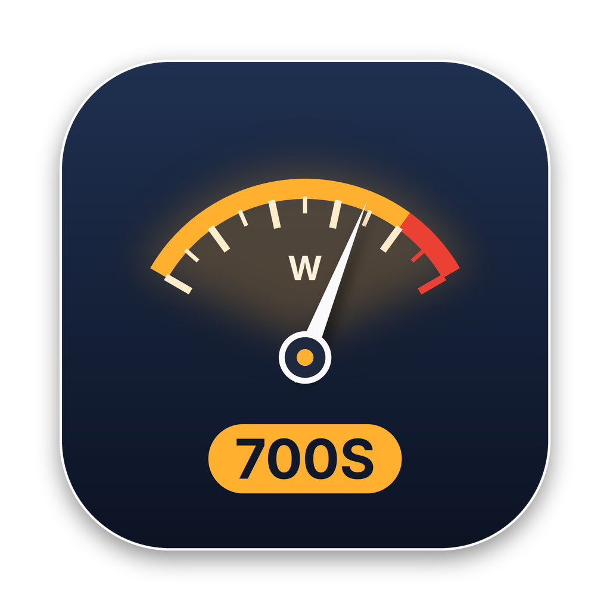

<p align="center"></p>

# ACOM Control for macOS

A native SwiftUI app for controlling and monitoring the **ACOM 700S** (and 500S / 600S / 1200S / 2020S) solid-state HF amplifier over its RS-232 remote port.

## Features

- **Operate / Standby / Off** buttons (⇧⌘O / ⇧⌘S, also in the *Amplifier* menu)
- Live output power and reflected power bars, with the over-nominal zone shaded red
- PA temperature, fan speed, drive power, SWR, active band filter, gain and DC efficiency
- Amplifier fault/warning banner with "Clear & Operate"
- Auto-reconnect on launch, optional keep-on-top window, **Demo mode** to try the UI with no amp connected

## Download

Grab **ACOM-Control-macOS.zip** from the [latest release](../../releases/latest), unzip it and drag **ACOM Control.app** into Applications. The first time, right-click → **Open**, because the app is ad-hoc signed rather than notarised.

## Build from source

You need a Mac on macOS 13 or later with Xcode or just the Command Line Tools (`xcode-select --install`).

```bash
cd ACOM-700S-Control
chmod +x build-app.sh
./build-app.sh
open dist
```

Drag **ACOM Control.app** into Applications. The first time, right-click → **Open** because it's ad-hoc signed, not notarised.

You can also open `Package.swift` in Xcode and press Run.

## Connecting

1. Plug a USB-to-RS-232 adapter (FTDI or Prolific recommended) into the 700S's **REMOTE** DB-9 port. A straight-through cable is used.
2. In the app, choose the adapter from the port menu (it will look like `cu.usbserial-XXXX`) and click **Connect**.
3. The status lamp shows `STANDBY`, `OPERATE` or `TRANSMIT` once telemetry is flowing. If it says *waiting for amplifier…*, check the cable and that the amp is switched on.

Settings (⌘,) let you pick a different ACOM model, which changes the meter scaling and temperature calibration.

## Protocol notes

9600 baud, 8N1, no handshake. The app sends `55 92 04 15` to enable telemetry (re-sent every 200 ms until data arrives) and parses 72-byte frames starting `55 2F`, validated by a zero-sum checksum. Command bytes and frame offsets come from Björn Ekelund SM7IUN's MIT-licensed [ACOM Controller](https://github.com/bjornekelund/ACOM-Controller) for Windows. DTR and RTS are held low at all other times so the 700S front-panel power button isn't blocked.

## Files

| File | What it does |
|---|---|
| `ACOMProtocol.swift` | Command bytes, telemetry frame decoder, model table |
| `SerialPort.swift` | POSIX serial I/O and DTR/RTS control |
| `AmplifierController.swift` | Connection, polling, peak-hold filtering, demo generator |
| `ContentView.swift` | Main window |
| `ACOMControlApp.swift` | App, menu commands, settings window |

## Licence

MIT — see [LICENSE](LICENSE). Protocol details are derived from SM7IUN's ACOM Controller, also MIT licensed (see `THIRD-PARTY-LICENSE-ACOM-Controller.txt`). Not affiliated with ACOM Ltd.

73 de GM0OTB
